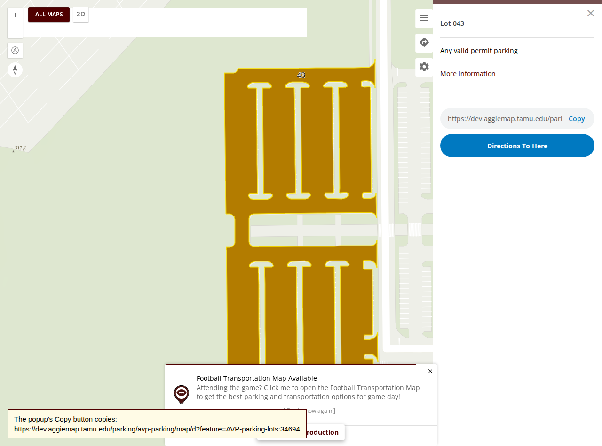
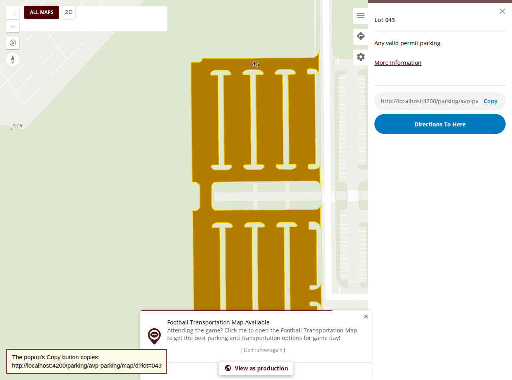
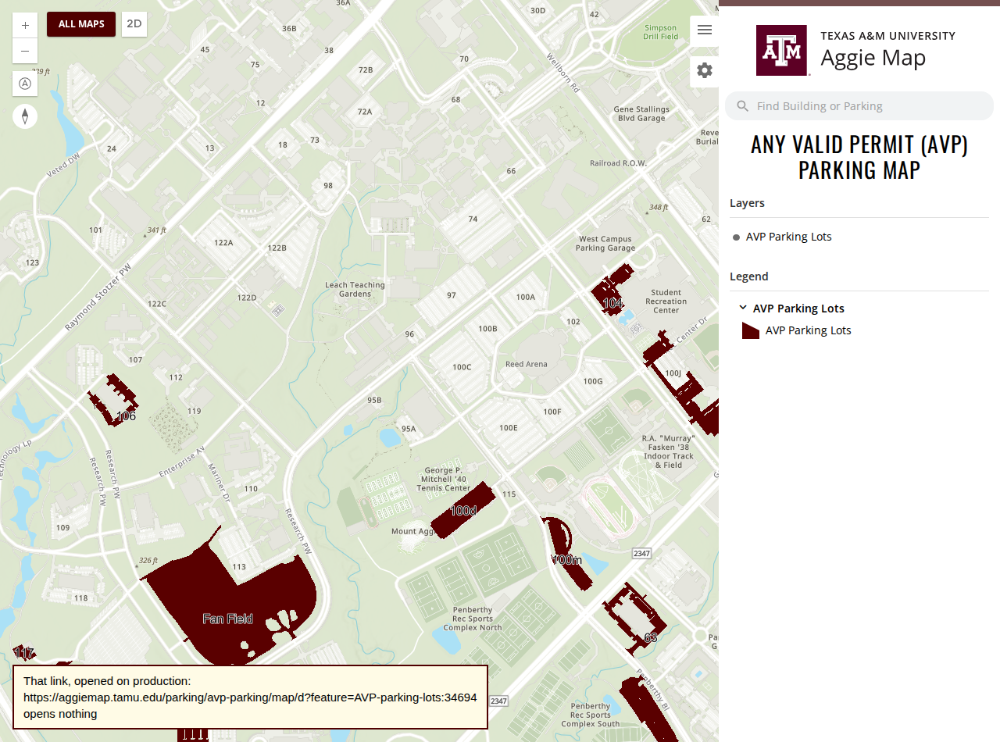
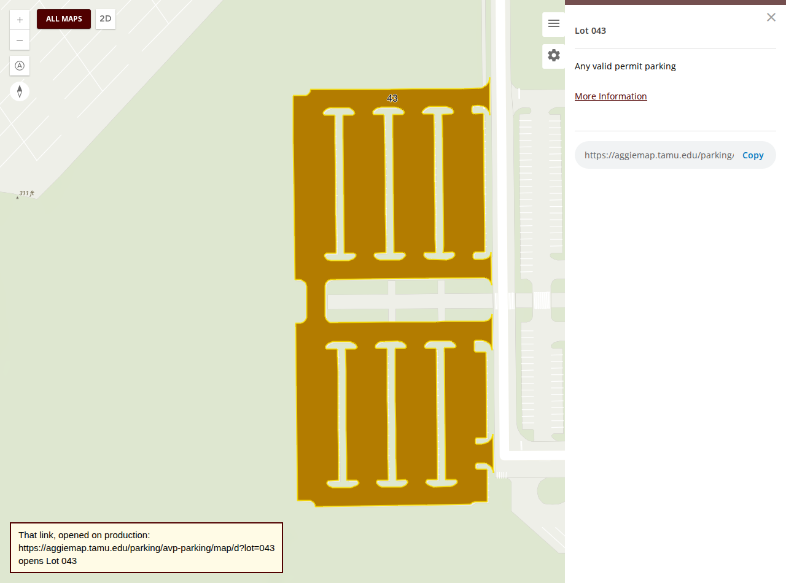

<!--
  Every pull request needs an issue behind it. Work on this project is reported to keep it funded,
  and that reporting is built from issues - a pull request with no issue does not appear in it.

  A CI check looks for one of `Closes #N`, `Fixes #N` or `Resolves #N` below. If there is genuinely
  no issue for this, open one first; it takes a minute and it is the whole point.
-->

Closes #2701

<!-- Director: #2701 has three items and three pull requests, and the linked-issue check needs a closing keyword in each, so all three say Closes #2701 and the first to merge closes it. -->

**Title:** `fix(ts-events-ngx): AVP Parking's lot popups copy ?lot=043, which opens the same lot on every server`

**Labels:** as on #2701 (a visible change: screenshots and a release note below).

## What this changes

Item 2 of #2701, as decided on 8 November: links should name a stable attribute, not an object id.

**What I found first, as asked: `?feature=` cannot take an attribute, but it doesn't need to.** `?lot=043` already opens AVP
Parking's Lot 043 on both servers, and so do `?lot=43` and `?lot=Lot 043` (checked on 8 November against
`main-M2EOIZCV.js` on production and dev's build). It goes through the application's own `lot` search source, which matches
`LotName`, `Name` and `FAC_CODE` against the map's own layer by each field's last part (#1952). **What wrote the object id was
the popup's Copy button**: it names a feature readably only from the map's *own* link sources (#1481), AVP declared none, and it
compared field names whole, so even a declared one would have missed `GIS.TS.ParkingLots.FAC_CODE`. So the fix is to the copied
link, through the mechanism #1481 already built, rather than a second way of naming a feature in `?feature=`:

- **`parkingLotLinkSource(url)`** in `definitions/common.definitions.ts`: a link-only (`searchActive: false`) `?lot=` source matched
  on `FAC_CODE`, Transportation Services' facility number, the same on every server. For any parking map whose lots carry it.
  **AVP Parking uses it.** Link-only, so the sidebar search keeps the application-wide sources.
- **`services/event/feature-links.ts`**: `fieldMatches`, the last-part rule the lookup has used since #1952, and
  `readableLinkIdentity`, the Copy button's choice, now using the same rule. `EventService` and `BaseEventPopupComponent` both use
  them, so the lookup and the copied link cannot disagree again.
- **Links already shared keep working**: `?feature=<layerId>:<objectId>` is read exactly as before.
- **The smoke suite's AVP fixtures** in `directions.spec.ts` move to `?lot=043`, which both servers resolve.

**Other parking maps** whose popups still copy an object id can take `parkingLotLinkSource` the same way; this pull request changes
AVP only, as the item asked. The report for batch 13 lists the question.

## Screenshots

Left: dev's build today. Right: this branch, on a local dev server. The yellow caption is added for the picture, because the Copy
field cuts the link off; it shows the field's whole text.

| Before | After |
| --- | --- |
|  |  |
|  |  |

## Release notes

- [x] Entry added to `docs/releases/unreleased/2701-avp-lot-links.md`, with screenshots
- [ ] Not user-visible (tests, CI, internal docs), so no entry needed

## How it was verified

On 8 November, in the Playwright container (`test/smoke/aggiemap/run-local.sh`):

| Run | Result |
| --- | --- |
| New check in `lot-links.spec.ts`, against dev's deployed build (unfixed) | **Failed, as it should:** *opened a popup that copies https://dev.aggiemap.tamu.edu/parking/avp-parking/map/d?feature=AVP-parking-lots:34694, an object id this server alone uses* |
| The same, against production (unfixed) | **Failed:** the same, with `:26135` |
| `lot-links.spec.ts` against this branch on a local dev server | **6 passed** |
| `directions.spec.ts` against this branch on a local dev server | **14 passed** |
| `directions.spec.ts`, with its fixtures on `?lot=043`, against dev's deployed build | **14 passed** |

- **Unit tests:** `feature-links.spec.ts`, 8 tests, on Lot 043's real attributes (the joined field names both servers return):
  `fieldMatches`, `readableLinkIdentity` (AVP's Lot 043 gives `{ lot: '043' }`; an exact field wins over a joined one; empty values
  and sources without a link parameter are skipped), and AVP's source being link-only. Run with Vitest: 8 passed.
- `npx tsc -p test/smoke/aggiemap`: exit 0. `node scripts/collate-release-notes.mjs --check`: 26 entries, no problems.
- `scripts/check-in-volume.sh fix/2701-feature-by-attribute ts-events-ngx,aggiemap-angular`: **exit 0**: `lint` and `test` of
  both, `build` of `aggiemap-angular`, 5 tasks, none from cache; then `lint.yml`'s steps.

**Until a release carries this, the new check fails on production's nightly run**, as any regression test does against an unfixed
build. Whether to list it as a known failure there in the meantime is a question in the batch 13 report.

🤖 Generated with [Claude Code](https://claude.com/claude-code)
