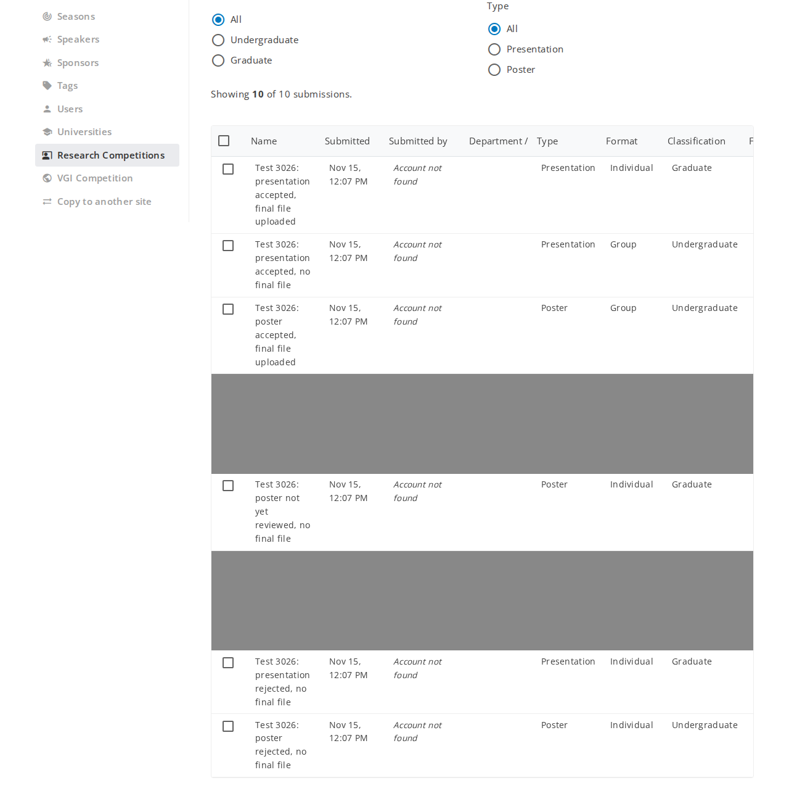
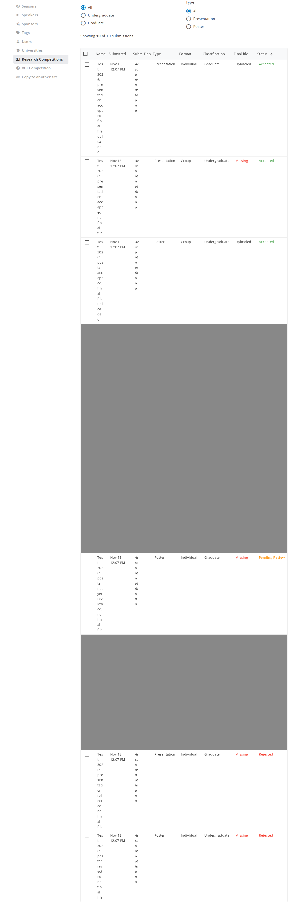
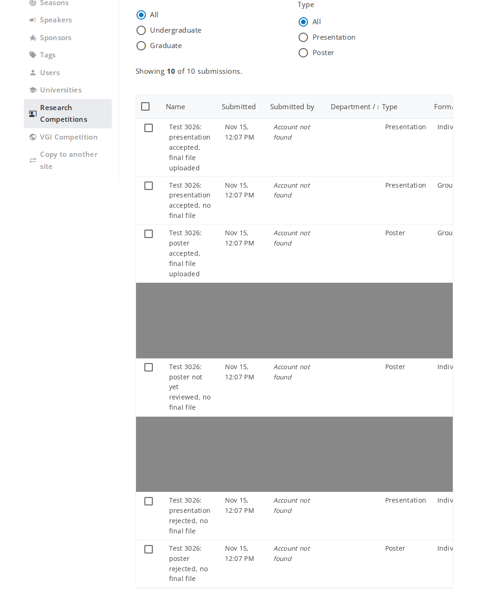
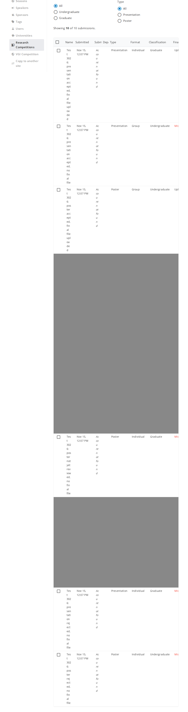

<!--
  Every pull request needs an issue behind it. Work on this project is reported to keep it funded,
  and that reporting is built from issues - a pull request with no issue does not appear in it.

  A CI check looks for one of `Closes #N`, `Fixes #N` or `Resolves #N` below. If there is genuinely
  no issue for this, open one first; it takes a minute and it is the whole point.
-->

Part of #3026 (closed by PR 3030; this is the maintainer's follow-up decision on it)

## What this changes

The maintainer's decision on #3026: at 1280 px the Research Competitions submissions table should fit its box without
scrolling, by lowering the minimums of the columns that wrap, and keep its inner scroll for narrower screens.

After PR 3030 the columns' minimums added up to 1100 px, in a box measured at 879 px at 1280. The columns that hold a
value whole keep theirs: select 56, Submitted 104, Type 112, Format 100, Classification 132, Final file 100, Status 136
= 740 px. That leaves 879 - 740 = **139 px** for the three that wrap, now **Name 55, Submitted by 46,
Department / major 38** (Name the widest). Each still grows in proportion wherever the screen is wider.

**The cost is large and visible in the screenshots:** with 23-39 px of text width, titles run to about fifteen lines,
"Account not found" breaks letter by letter, and a long word or an email breaks mid-word (one over 24 lines). The
Submitted by and Department / major headings are cut. At 1024 px the same minimums apply, so those columns are as
narrow there too, while the table scrolls 198 px in its own box instead of 419.

## Screenshots

Research Competitions, sorted by Status, local test submissions (other rows greyed out, site header masked).

| Width | Before (`origin/development`) | After |
| --- | --- | --- |
| 1280 |  |  |
| 1024 |  |  |

## Release notes

- [x] Entry added as `docs/releases/unreleased/3026-columns-fit-1280.md`, with screenshots
- [ ] Not user-visible (tests, CI, internal docs), so no entry needed

## How it was verified

- Two new unit tests in `research-competition-list.component.spec.ts`: the columns' narrowest total is at most 879,
  and the width comes from the wrapping columns (Name the widest of them, Classification still at least 107 + 16).
  Red against `development`: `Expected: <= 879, Received: 1100` and `Expected: 130, Received: 120`. Green after: 23 of
  23 in the file, PR 3030's tests unchanged.
- `scripts/check-in-volume.sh fix/3026-columns-fit-1280 gisday-platform-ngx-core,gisday-angular`: exit 0, lint, test
  and build for both, and `lint.yml`'s steps.
- Playwright on the local stack, at 1280: table content 879 px in an 879 px box, no inner scroll (maximum scroll 0),
  every column in view, no value in Submitted, Type, Format, Classification, Final file or Status broken or cut, the
  checkbox 32 px clear of the title, the page never wider than the window. At 1024: content 879 in 681, scrolling
  198 px in its own box to Final file and Status. No write request left the page.
- `node scripts/collate-release-notes.mjs --check`: no problems.

🤖 Generated with [Claude Code](https://claude.com/claude-code)
