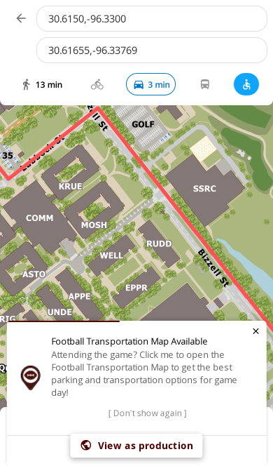
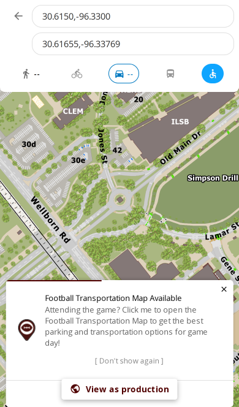
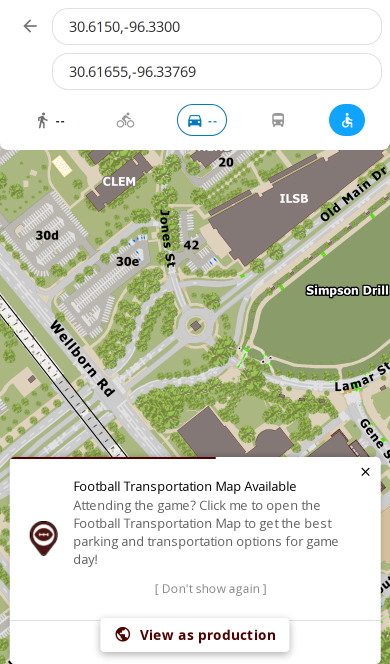
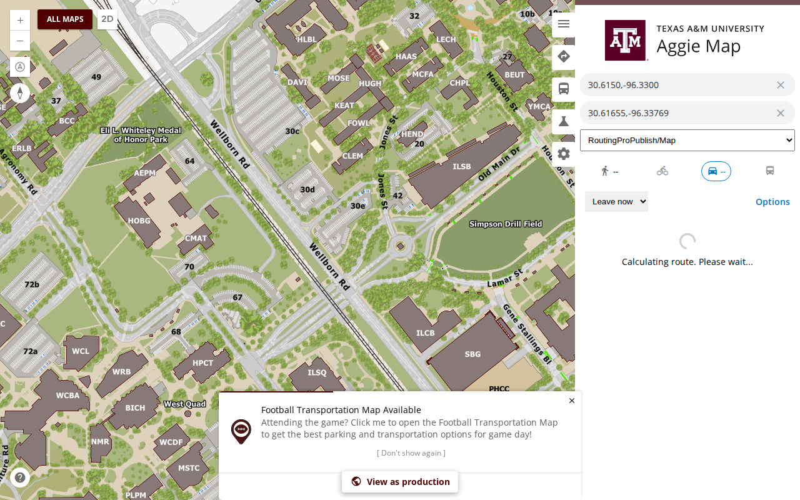
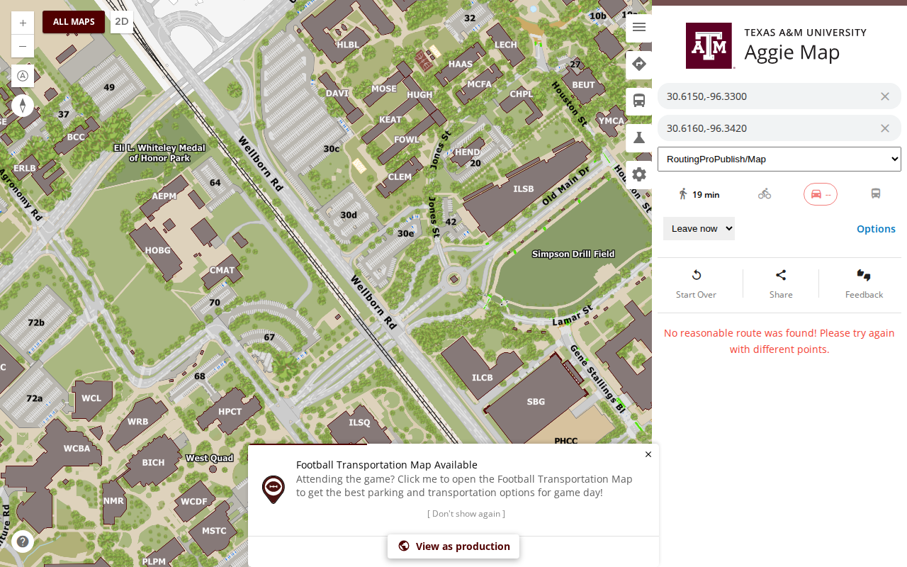

Closes #3490

## What this changes

**The phone's directions, and their actions, now render the desktop's templates.** Each had a phone template of its own beside the
desktop's. The two actions templates were byte-identical. The two directions templates had drifted: the phone's always drew its actions, and
had no "Calculating route" or "No reasonable route was found!" feedback.

- **`trip-planner-directions`** gains a `layout`, `'desktop'` or `'mobile'`. The mobile layout adds only two things to the shared template:
  the bottom sheet's drag handle, and the phone's actions.
- **`trip-planner-directions-actions`**: the phone's component renders the base template. Its stylesheet stays, because its two lighter
  borders are a real difference, not drift.
- **Both phone classes stay.** The bottom sheet hosts its drag directive on `tamu-gisc-trip-planner-directions-mobile`, and each class carries
  its stylesheet. So `trip-planner-bottom`, which is in open PR 3653, is untouched.
- **Both phone templates are deleted.**

### What a phone shows: unchanged, and why

**The bottom sheet exists only for a found route**: `trip-planner-bottom` draws it when `result()?.isFulfilled && !result().isError`. For a
found route, both templates drew the same thing: the overview, the actions and the steps. The states that drifted are calculating and
no-route, and there the phone shows no sheet at all, before and after. Its only signal is the top bar's "--" against the mode.

So a phone user sees no difference. The shared template would now give them the desktop's feedback, but only once the sheet is shown in
those states, and that is `trip-planner-bottom`'s gate, not this change.

## Screenshots

Before is `development` at `2cfb0bc43`; after is this branch. Both on the local dev server, the map drawn and any notice closed.

**Phone (iPhone 13), a visitor's drive from University Dr to the Central Campus Garage.** The sheet is the same.

| Before | After |
| --- | --- |
|  |  |

**Phone, while the route is calculating.** No sheet, before or after; the top bar shows "--".

| Before | After |
| --- | --- |
|  |  |

**Desktop, calculating, then no route.** Unchanged.

| Before | After |
| --- | --- |
|  |  |
|  |  |

## Release notes

- [ ] Entry added to `docs/releases/unreleased.md`, with screenshots
- [x] Not user-visible (tests, CI, internal docs), so no entry needed

No entry, because nothing a visitor can reach changes (above). Labelled `no-visible-change`; the images above are what shows it.

## How it was verified

- **The sheet, at phone width (iPhone 13, 390 x 664), on both builds**, the same script:
  - empty, calculating and no-route: no sheet on either;
  - a route: the sheet rests with 84 px showing, the handle present, and the same text;
  - a real touch drag (Chrome DevTools touch events) moves it up 350 px to top 245 on both, and the drag back down leaves it there on both.

  **That drag-down behaviour is the same before and after**, so it is not this change.
- **Pixel comparison of the phone route sheet:** 150 of 2,330,640 pixels differ, in a 5 px strip at the notice's edge.
- **The text of every state**, phone and desktop, empty, calculating, route and no route: identical before and after, apart from the clock in
  "Start at … at 02:16 PM".
- **A spec**, `trip-planner-directions/containers/mobile/mobile.component.spec.ts`, pins the two layouts together. It has four cases:
  - the phone draws the handle and the phone's actions, and the desktop neither;
  - the calculating feedback;
  - the no-route feedback;
  - the same overview.

  **Against the unchanged code, the calculating and no-route cases fail**: `expected '' to contain 'Calculating route. Please wait...'` and
  `expected '' to contain 'No reasonable route was found!'`. The other two pass on both, because they pin what stays the same.
  `nx test maps-feature-trip-planner`: 63 of 63.
- **`scripts/check-in-volume.sh`** (affected): **`Exit 0`**. Lint and test on 14 projects, and build on the 3 affected apps.
- **`scripts/pre-pr-check.sh`**: with the title above, this body and `no-visible-change`: `pre-pr-check: Exit 0 (refactor/3490-directions-shared-templates): ready to open.`

🤖 Generated with [Claude Code](https://claude.com/claude-code)
