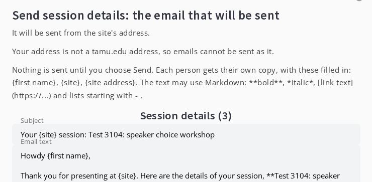
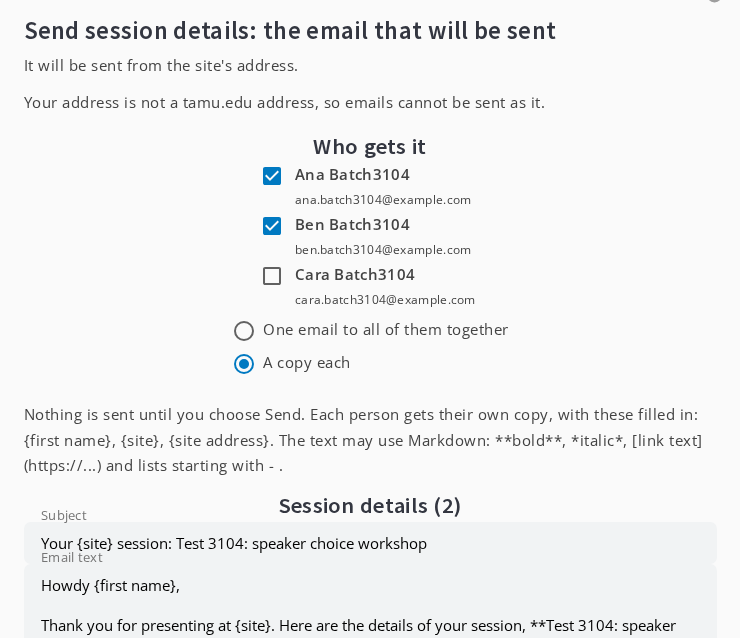

<!--
  Every pull request needs an issue behind it. Work on this project is reported to keep it funded,
  and that reporting is built from issues - a pull request with no issue does not appear in it.

  A CI check looks for one of `Closes #N`, `Fixes #N` or `Resolves #N` below. If there is genuinely
  no issue for this, open one first; it takes a minute and it is the whole point.
-->

Closes #3104

## What this changes

**Stacked on #3100 (Send as), which is not merged yet.** This branch starts at `e9bbcdd7d`, the last commit of `feat/3100-send-as` before its pull request body, because #3100 changes the same email window. Merge #3100 first; until then this pull request's diff also shows #3100's commits. Only the three commits after `e9bbcdd7d` are this change.

The shared email window (`ReviewEmailModalComponent`) now lets the admin choose which speakers get a speaker email, and whether they get it together or a copy each, as the maintainer decided on #3104 (1A, widened to every speaker email).

- **Who gets it.** A speaker email's preview lists its speakers with an address (`recipients`), and the window shows each with a tick box, their name and their address, all ticked to start. Anyone with no address is still named above, as before. Send is disabled, and does nothing, with no one ticked.
- **One email to all of them together, or a copy each.** With more than one ticked, the window offers both, together chosen. Together, one email goes with every ticked speaker on To (`"a@…, b@…"`, which the mailroom's `addressparser` reads as a list), and `{first name}` names them all: "Ana and Ben", "Ana, Ben and Cara" (`joinNames`, `togetherFirstNames` in `libs/gisday/common/src/lib/email-recipients.ts`). The preview shows exactly that email, every address on To, and the button counts it as 1 email. A copy each previews the first ticked speaker and counts one per speaker.
- **Session details email (#3092).** `POST session-emails/details` takes `speakers` (the ids ticked; only the session's own speakers with an address are used) and `together`. A choice of no one, or of no one on the session, is refused with a 400.
- **The repeat guard counts a together send once, for its whole group.** It checks every member's `<session>:<speaker>` record and records them all at the same moment, with nothing awaited between, so a repeated together send is skipped once, naming the group, rather than once per speaker; each member then counts as emailed for a later copy each. A failed together email clears all of its records, so it can be sent again at once.
- **Profile email (#3023): tick boxes, and a copy each only.** Each copy carries that speaker's own link to edit their profile, and the link works for anyone holding it, so one email to several would let each edit the others' profiles. The preview sends a `copyEachReason`, which the window shows in place of the choice ("Each speaker gets their own copy: it carries their own link to edit their profile, which no one else should have."). `sendProfileEmail` never passes `together`, and the API refuses `together` on `speaker-edits/send` and `send-for-submissions` with a 400 before anything is sent. The ticked speakers go as `speakers`: on `send` they replace the page's list; on `send-for-submissions` they narrow the speakers matched. This is a question for the maintainer below.
- **Empty broadcast lines left out.** The session details email no longer writes "Dial-in number: None"; the dial-in line is now left out with no number, as the password and meeting ID lines already were.
- **For the slides request (#3113):** any speaker email opts in by returning `recipients` in its preview, and `copyEachReason` to forbid together; `sendEditableEmail` passes `speakers` and `together` on to its send.

Reuse: the tick boxes are the shared `tamu-gisc-checkbox-group` and `tamu-gisc-checkbox`, and the choice the shared `tamu-gisc-radio-group`, all from `libs/ui-kits/ngx/forms`; the section reuses the window's own `review-email__group` class, with no new CSS. The window's result carries the choice under `:recipients` and `:together`, beside the texts, as #3100's `:sender` does, read by `withoutRecipients`. I looked in `libs/ui-kits/ngx/forms` (checkbox, checkbox-group, radio-group, select-list), `libs/gisday/common` (no list-joining helper existed; `reminderSkipSummary` joins two fixed phrases only) and `libs/common` before adding `email-recipients.ts`.

## Screenshots

On the local site at 1280 px, as the local test admin, with a made-up hybrid session ("Test 3104: speaker choice workshop"), a made-up broadcast with a link and meeting ID but no dial-in number or password, and three made-up speakers with example.com addresses, all deleted afterwards. Before is `e9bbcdd7d` (#3100); after is this branch. Nothing was sent.

| | Before | After |
| --- | --- | --- |
| Session details: the window's top |  |  |
| Session details: the preview |  |  |
| A copy each, one speaker unticked | |  |
| Profile email |  |  |

Before, the preview is "as Ana Batch3104 gets it", To one address, with "Dial-in number: None". After, it is "the one email to all of them", To all three, "Howdy Ana, Ben and Cara,", with no dial-in line, and the button says Send 1 email. The local test account's address is not a tamu.edu one and the local site has no `MAILROOM_FROM`, so the windows say the email will go from the site's address.

## Release notes

- [x] Entry added to `docs/releases/unreleased/3104-speaker-choice.md`, with screenshots. It says GIS Day has no dev site.
- [ ] Not user-visible (tests, CI, internal docs), so no entry needed

## How it was verified

- **Red first, the new specs against the unmodified base `e9bbcdd7d`:**
  - `gisday-common`: `email-recipients.spec.ts` could not resolve `./email-recipients`; the session details spec failed because the email had "- **Dial-in number:** None" between the link and the meeting ID.
  - `gisday-platform-data-api`: the service specs did not compile (TS2339: no `recipients` or `copyEachReason` on the previews; TS2554: `send` and `sendLinksForSubmissions` took at most 4 arguments). The controller specs failed on assertions (6 of 10): no choice reached the services, and a profile email asked to go together was accepted (201, not 400).
  - `gisday-platform-ngx-common`: 9 of 24 failed: no tick boxes, no choice, the To line and greeting for one speaker, and `sendEditableEmail` dropped the speakers and together.
  - `gisday-platform-ngx-data-access`: its 2 new tests passed on the base too, because the client already spreads the email into the request body; only the `ProfileEmail` type gained `speakers` and `together`.
- **Green:** gisday-common 15, data-api `speaker-edit/` 67, ngx data-access 9, ngx common 24, all passing. Four existing controller expectations gained the choice argument (`undefined` when none is given), and the old "Dial-in number: None" expectation was replaced by the new one.
- **Full check:** `CHECK_MEMORY=24g CHECK_PARALLEL=3 scripts/check-in-volume.sh feat/3104-speaker-choice` on the code commit `a3a65030f` exited 0. It ran lint, test and build for 11 projects and the 1 task they depend on (26 tasks, Cache 0/26), including `gisday-angular:build` within its budgets and `gisday-nest:build`, then `lint.yml`'s steps, each exit 0. The commits after it add only screenshots, the release note and this body.
- `node scripts/collate-release-notes.mjs --check`: 68 entries, no problems.
- **Screenshots:** every same-origin request that was not a GET or one of the two previews was aborted (271 blocked, all `HEAD` requests for the placeholder image), and each window was closed with Cancel; Send was never pressed. Every `MAILROOM_` setting was blank, so there was no mail endpoint. The test data was removed, and a before and after snapshot of the database compared identical with `cmp`.
- Not verified here: a real together email through the relay, and how mail clients show a To line of several speakers.

🤖 Generated with [Claude Code](https://claude.com/claude-code)
