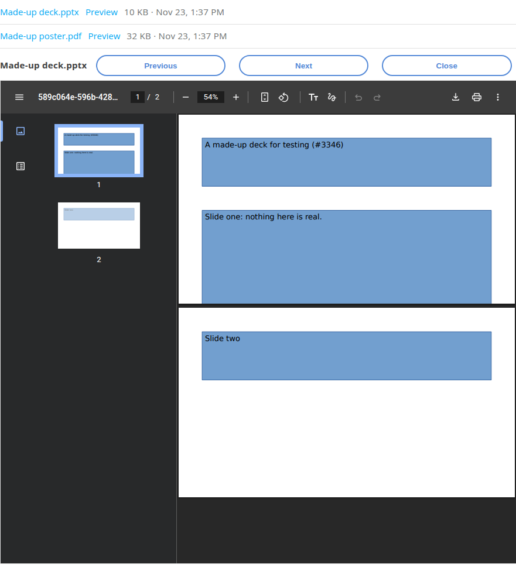

Title: feat(gisday-pptx-preview): PowerPoints preview on a submission's review page, through a conversion service

Closes #3346

## What this changes

An admin reviewing a research competition submission could preview its PDFs in the page (#3090), but a PowerPoint had
no Preview and had to be downloaded. This previews PowerPoints too, the way the maintainer chose on #3346: the conversion
runs in a service of its own, not in the API.

- **`apps/gisday-pptx-preview`**, a new service: `POST /convert?name=<file>` with a `.ppt` or `.pptx` body answers the PDF,
  converted by LibreOffice in its own profile folder; `GET /health` answers 200. It refuses any other file (415), a body
  over `MAX_BYTES` (413; 100 MB by default, as large as the API accepts an upload, which its spec holds), and kills a conversion past `TIMEOUT_MS` (504, 60 s); a failed conversion is a 502. No
  dependencies, so `main.js` is the whole app. Its image (`src/Dockerfile`) is `node:24.22.3-alpine` with `libreoffice`
  and `ttf-dejavu`, runs as `node`, and is about 1.8 GB as Docker reports it. LibreOffice stays out of the API's image on
  purpose: the API stays small, and a LibreOffice crash cannot take it down.
- **The API** (`SubmissionFilesService.preview`): a PowerPoint's first preview asks the service through the new
  `PptxPreviewConverter` (at `PPTX_PREVIEW_URL`), keeps the PDF beside the deck as `<path>.pdf` under `APP_DATA`, written
  whole and renamed into place, and serves it inline as PDFs are served. Later previews serve the kept PDF without
  converting again. Removing the file removes its kept PDF. **When the service is unset, down, slow or refuses the deck,
  the answer is as before, 415, never a 500.**
- **The review page** (`SubmissionFilesComponent`): Preview is offered on PowerPoints as on PDFs, reads "Preparing
  preview…" while the first conversion runs, and Previous and Next page through all of them. On a 415 the deck is
  downloaded, as before, with a line saying it cannot be previewed right now.
- **The local stack**: `scripts/gisday-local.sh preview` builds the service and its image and starts it on the stack's
  network; `api` passes `PPTX_PREVIEW_URL`; `stop` removes it. `docs/gisday-local.md` and both settings samples say so.

**Deploying it needs kubernetes-config** (private, so not described further here): a Deployment and Service for the new
image beside the API's, and `PPTX_PREVIEW_URL` set on the API. Until then production behaves exactly as today, because
the variable is unset and every PowerPoint downloads.

## Screenshots

Production builds of this branch and of its base, `86c9013d9`, with sign-in and the API stubbed; the submission and its
files are made up, and the preview is the made-up deck's PDF as the service converted it.

| Desktop, 1280 pixels | Before | After |
| --- | --- | --- |
| A submission's files |  |  |
| A PowerPoint previewed | |  |

## Release notes

- [x] Entry added as `docs/releases/unreleased/3346-gisday-powerpoint-preview.md` (`app: gisday`), with screenshots
- [ ] Not user-visible (tests, CI, internal docs), so no entry needed

## How it was verified

- **Red first, then green.** The API's preview: 3 of 4 new cases failed on the unchanged service (the fourth, the 415
  fallback, is today's behaviour), then 177 of 177 in `user-submission/`. The review page: 4 new cases failed, then 24 of
  24. The local script: 6 new cases failed, then `bash scripts/gisday-local.test.sh` all passed. The service: its 7
  server tests failed with the module missing, then passed; `soffice.spec.ts` runs where LibreOffice is installed and is
  skipped in CI's Node image.
- **The service for real**: the image built, and the made-up two-slide deck in `src/fixtures/` came back as a 2-page PDF
  of 19,848 bytes in 877 ms, then 818 ms; a `.docx` got 415; `/health` 200; the process runs as `node`.
- **End to end**: the real `SubmissionFilesService` and `PptxPreviewConverter` against the running service converted the
  deck on first preview in 1.07 s, kept a 19,848-byte PDF beside it, and served the second preview from it in 0 ms.
- **The local step**: `scripts/gisday-local.sh preview` built and started the service in 55 s, and it answered `/health`
  with 200 by name on the stack's network.
- `tsc` on `gisday-platform-data-api`'s library and spec configurations: no errors.

- `CHECK_PARALLEL=1 scripts/check-in-volume.sh feat/3346-pptx-preview-service affected`: lint and test on all 11
  affected projects and the production build of `gisday-nest`, `gisday-pptx-preview` and `gisday-angular` passed, and
  every `lint.yml` step but one. The first run also found three unformatted files and a type error in the service's spec,
  fixed in 7674eb08e. The one failure left is `check-parked-code.mjs`: the tag `parked/season-day-writes` has no row in
  `docs/parked-code.md`. That fails every branch today and is fixed by PR 3797, so this must be run again once that
  merges.

```
pre-pr-check: Exit 1 (feat/3346-pptx-preview-service). Failed: check-in-volume.sh (lint, test, build, lint.yml's steps). Do not open the pull request yet.
```

🤖 Generated with [Claude Code](https://claude.com/claude-code)
