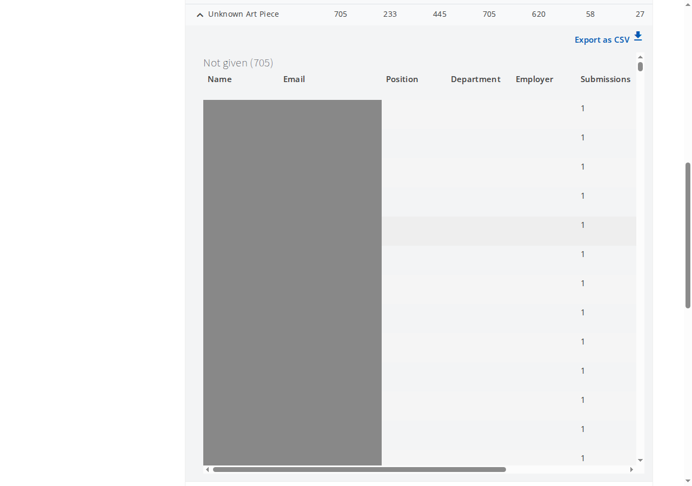
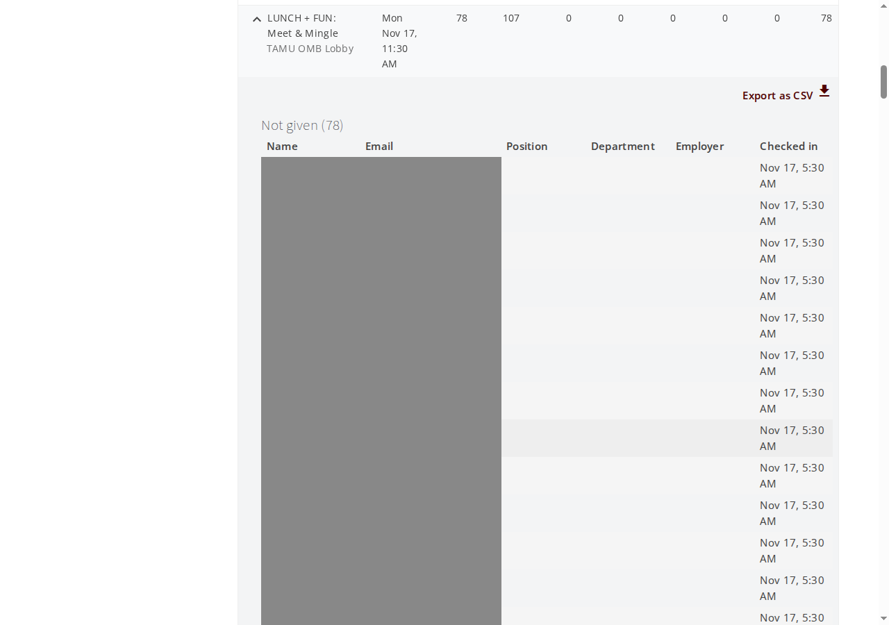

<!--
  Every pull request needs an issue behind it. Work on this project is reported to keep it funded,
  and that reporting is built from issues - a pull request with no issue does not appear in it.

  A CI check looks for one of `Closes #N`, `Fixes #N` or `Resolves #N` below. If there is genuinely
  no issue for this, open one first; it takes a minute and it is the whole point.
-->

Closes #3120

**Stacked on #2894 (PR 3121, not merged).** This branch starts at `feat/2894-vgi-dashboard` (`4e1bceceb`, which has
`development` merged in), because the shared `DashboardScrollComponent` it changes arrives with that pull request. Until
PR 3121 merges, the diff against `development` includes all of #2894; the three commits of this change are on top. It
rebases onto `development` once PR 3121 merges.

## What this changes

On Admin, Dashboards, VGI submissions, opening a feature type with 705 submitters (2025's Unknown Art Piece) drew the
people's box as tall as all of them, 38,188 px, so its own sideways scrollbar, the only way to the count and date
columns, was about 38,000 px down the page.

- **`DashboardScrollComponent` gains a `capped` input.** A capped box is at most `calc(100vh - 8rem)` tall, scrolls up
  and down inside itself, and keeps its own sideways scrollbar instead of a rail (its bottom is in view whenever the
  box is). 8rem holds the opened row's name and "Export as CSV" above the box (about 90 px at 1280 px) and the
  dashboard table's rail below. It is a `max-height`, so a short list is only as tall as its people. The page's header
  scrolls away, so it needs no room.
- **`DashboardPeopleComponent` caps its box**, so every dashboard's opened row is capped: RSVPs, Check-ins, User
  accounts and VGI submissions. The dashboard table's own box is not capped, and keeps its rail (#3029).
- **The email column's narrowest goes from 200 to 190 px.** A capped long list has an up-and-down scrollbar, which
  took 15 px of the 816 px an opened row gives its people at 1280 px; the six columns' 810 px then grew a sideways
  scrollbar on every long RSVP and check-in list. They are now 800 px, and the test holds them to that.

Sticky headers were not added: the people table is a plain table of its own, not the shared `floating-table` (which has
sticky headers but different padding and `nowrap` cells), so the shared table does not already support them. A question
for the director.

Where I looked first: `libs/ui-kits/ngx/**` and `libs/sass/` (`modules/_tables.scss` has the only sticky table header),
and the dashboards' own shared pieces, where #2894 put `DashboardScrollComponent`; the cap is an option on it, not new CSS
elsewhere.

## Screenshots

At 1280 x 900, in a local copy (GIS Day has no dev site), Chromium with scrollbars shown, names and emails blanked:

| Before | After |
| --- | --- |
|  |  |
| |  |
|  |  |
|  |  |

## Release notes

- [x] Entry added to `docs/releases/unreleased/3120-people-scroll-cap.md`, with screenshots
- [ ] Not user-visible (tests, CI, internal docs), so no entry needed

`node scripts/collate-release-notes.mjs --check`: 75 entries read, 75 with a What to test on dev row, no problems.

## How it was verified

- **Unit tests, red first.** Against `4e1bceceb`, 4 of the new tests failed for the expected reasons: the capped box had
  no `dashboard-scroll-capped` class (twice, the scroll and the people component); a capped box wider than its content
  got a rail (`overflow()` was 1100, not null); and the stylesheet had no capped rule. The column-width test, tightened
  to 800 px, failed with 810. All 32 pass with the fix. jsdom has no layout and the tests get no component styles, so
  the rule is read from the component's stylesheet, as `event-add-edit-form.component.spec.ts` reads its template.
- **Playwright, 1280 x 900, before and after**, the row's name at the top of the window:
  - VGI, Unknown Art Piece (705): the people box was 38,188 px tall, its bottom at 38,285 px, its sideways scrollbar
    (15 px) not in view, the page 40,293 px tall. After: 780 px tall (`max-height` 780 px), bottom at 877 of 900, the
    scrollbar in view, the page 2,885 px tall; scrolled sideways to its end (329 px). `scrollWidth <= innerWidth`
    (1265 <= 1280) both times.
  - RSVPs as gisday.tamu.edu, 2025, and Check-ins, the largest event opened: the box capped at 780 px; at 1280 px no
    sideways scrollbar (801 = 801 and 807 = 807), as before (816, 822). No heading cut, in the people tables or the
    dashboard tables, before or after. At 1280, 1024 and 800 px, closed, the dashboard tables fit their box, so the
    rail (#3029) was not needed and not shown, before and after alike; the rail's own unit tests pass.
  - Signed in once per run; no consent screen; every same-origin write blocked (0 attempted).
- **`CHECK_MEMORY=24g CHECK_PARALLEL=3 scripts/check-in-volume.sh fix/3120-people-scroll-cap gisday-platform-ngx-core,gisday-angular`**
  on `06a427765`: exit 0, lint, test and build for both projects and 2 dependencies, Cache 0/7 hit.
- `git diff --stat 4e1bceceb` and `--ignore-all-space` agree (16 files, 153 insertions, 10 deletions); every file LF.

🤖 Generated with [Claude Code](https://claude.com/claude-code)
