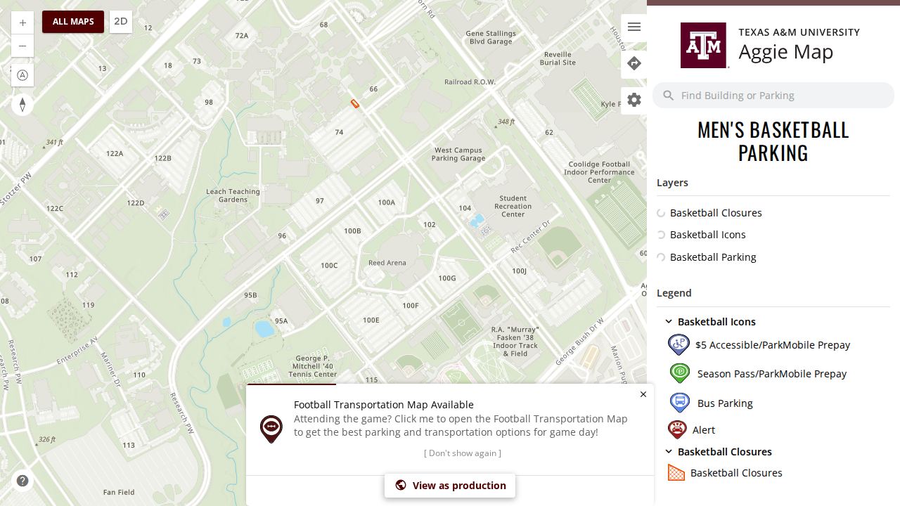
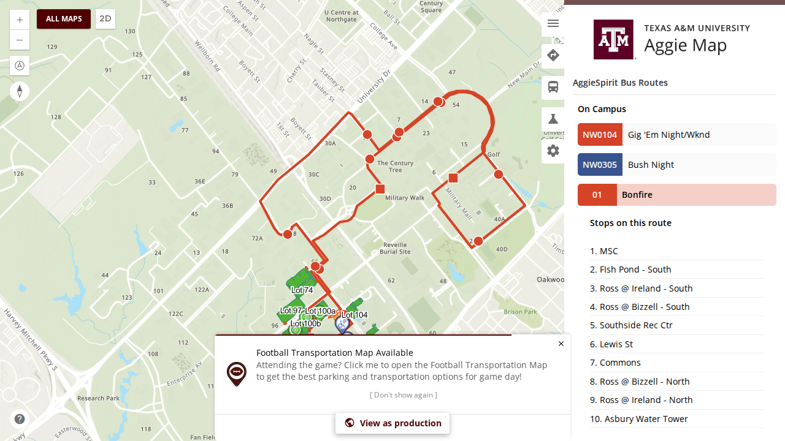

<!--
  Every pull request needs an issue behind it. Work on this project is reported to keep it funded,
  and that reporting is built from issues - a pull request with no issue does not appear in it.

  A CI check looks for one of `Closes #N`, `Fixes #N` or `Resolves #N` below. If there is genuinely
  no issue for this, open one first; it takes a minute and it is the whole point.
-->

Closes #2758

## What this changes

The maintainer, 9 November 2026: the bus side panel and the routing side panel need to be available across all maps.

**The fault was drift.** The main map's sidebar and the one every event, parking and campus map uses each kept their own
copy of the tab list. Bus Routes and Experiments were added to the first and never to the second. So no event or parking
map offered bus routes, on either environment.

**One list now, so the next tab cannot drift.** `AGGIEMAP_SIDEBAR_TABS` (`libs/aggiemap/ngx/ui/desktop`, beside the main
sidebar) holds every tab, with its development-only reason where it has one. Both sidebars draw from it:

- **Every event and parking map** now offers Features, Bus Routes and Settings on production, plus Directions and
  Experiments on dev, exactly as the main map does.
- **Directions keeps its one development-only gate.** When #2804 removes it, Directions appears on every map at once.
- **A map can still keep only some tabs** by naming them in its `sidebarTabs`. The ten satellite campus maps keep
  Features alone, unchanged.

**What else the tabs needed, found by using them:**

- **Routes:** event maps had no `bus` or `experiments` route, so the new tabs would have led nowhere. They have them now.
- **The bus service:** an event map provides its own `EsriMapService`, but `BusService` was the application's, waiting
  on the application's map. So on an event map, choosing a route threw `Cannot read properties of null (reading
  'graphics')` and drew nothing. Event maps now provide their own `BusService`, as they already do `TripPlannerService`.

**Not changed:**

- **The phone menu.** Its Bus Routes item already works on every map, but it is an absolute link to `/map/m/bus`, so on
  an event map it opens the main map's bus list. Making it open the event map's own list needs mobile bus routes on
  event maps, which is a separate change.
- **The trip planner and its mode picker.** Directions is only listed here; #2801 and #2804 own the planner.

## Screenshots

| Before: dev today, the Men's Basketball map with Features, Directions and Settings only | After: this branch, the same map with Bus Routes, route 01 drawn with its stops |
| --- | --- |
|  |  |

## Release notes

- [x] Entry added to `docs/releases/unreleased/2758-sidebar-tabs-every-map.md`, with screenshots
- [ ] Not user-visible (tests, CI, internal docs), so no entry needed

## How it was verified

**The check across maps is two checks, since one list now draws every map's tabs:**

- **A unit spec** (`ts-events-ngx`, `sidebar.component.spec.ts`) renders both sidebars and requires an event map to
  offer exactly the main map's tabs on a development host and on production. A map that names its tabs gets only those.
  **Red on the old templates:** the event map offered `Features, Directions, Settings` against the main map's five, and
  `Features, Settings` against three as production. Green with the change, 5 of 5.
- **The smoke suite** checks each section on an event map as well as the main map (`development-only.spec.ts`).
  - **Red against dev today:** "the Bus Routes tab is not offered on /events/mens-basketball", and the Experiments tab
    missing there.
  - **Green on this branch** as development (`local`) and as production (`local-production`), 6 of 6 each.

**The bus panel working, not just its tab:** `bus.spec.ts`'s route 01 test runs on `/events/mens-basketball/map/d/bus`
as well as the main map.

- **Red without the `BusService` provider:** "choosing the route did not list its stops", on the event map only.
- **Green with it** on `local` and `local-production`, 2 of 2 each. The event map then requests route 01's line and
  stops and draws both.

**`collate-release-notes.mjs --check`:** no problems.

**`scripts/check-in-volume.sh <branch>`** (full affected): **exit 0**, a clean `npm ci`, lint, test and build for the 8
affected projects (`aggiemap-angular`, `ts-events-angular` and `ues-operations-angular` built, with their budgets), the
smoke `tsc`, and the other `lint.yml` steps.

🤖 Generated with [Claude Code](https://claude.com/claude-code)
