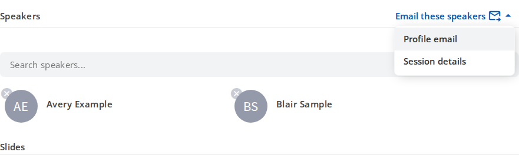
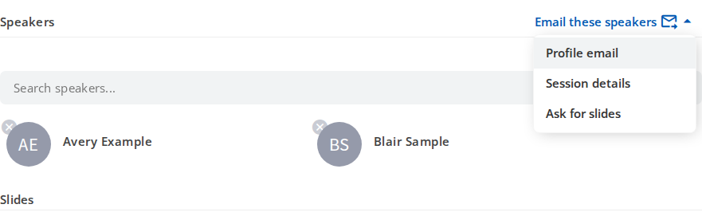
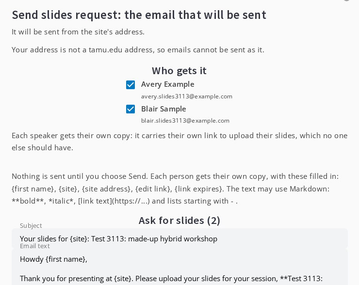
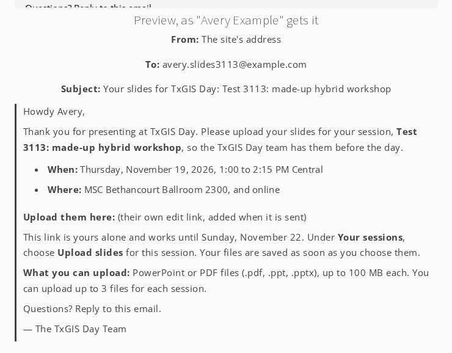

<!--
  Every pull request needs an issue behind it. Work on this project is reported to keep it funded,
  and that reporting is built from issues - a pull request with no issue does not appear in it.

  A CI check looks for one of `Closes #N`, `Fixes #N` or `Resolves #N` below. If there is genuinely
  no issue for this, open one first; it takes a minute and it is the whole point.
-->

Closes #3113

**Stacked on #3104 (PR 3119), which is not merged yet.** This branch starts at `973726e65`, the head of
`feat/3104-speaker-choice-rebuilt` (`development` + #3104 + #3100's Send as), so until PR 3119 merges this diff also
shows #3104's three commits. Merge PR 3119 first; this one's own commits are the last three.

## What this changes

A third item in a session's **Email these speakers** menu (#3092): **Ask for slides**. It opens the shared composer
with a template of its own, subject and Markdown text, previewed and editable:

- **The session**: its name, day and time in Central, and room, from `sessionWhen` / `sessionWhere`, now shared with
  the session details email rather than written twice.
- **Where to upload**: each speaker's own edit link, the presenter page whose **Your sessions** takes their slides
  (#3093). It is the profile email's own kind of link, made by `SpeakerEditService.newLink`, which `emailLink` now uses
  too; there is no second kind of link. The preview shows the profile email's stand-in, never a real link.
- **What may be uploaded**, from the upload rule, not typed: `SESSION_FILES_RULE` in `libs/gisday/common`'s
  `submission-files.ts` is built from `SUBMISSION_FILE_RULES` and `SESSION_FILES_LIMIT` ("PowerPoint or PDF files (.pdf,
  .ppt, .pptx), up to 100 MB each. You can upload up to 3 files for each session.").

**Always a copy each (decided 1A).** Every copy carries its speaker's own link, so the preview lists the speakers for
#3104's tick boxes with a `copyEachReason`, the composer offers no "together" and says why, `sendSlidesRequestEmail`
never sends together whatever the window returns, and the API refuses `together: true` with 400 before anything is
sent (`refuseTogether`, now exported with the reason as a parameter).

**The API:** `POST session-emails/slides` and `session-emails/slides/preview` (`SlidesRequestEmailController`), behind
`update:speakers` with `JwtGuard` and `PermissionsGuard`, as the profile email's routes. The chosen **Send as** sender
is checked with `EmailSenderService.resolve` before anything is sent, and used (#3100). Only the session's own speakers
of those ticked are emailed.

**The repeat guard**, as the other speaker emails: a speaker asked for a session's slides in the last
`REPEAT_SEND_MINUTES` is skipped and named; several are sent at a time with `inParallel`; a failed email is released so
it can be retried. Its in-process per-speaker record is the session details email's, moved into
`_base/recent-sends.ts` (`RecentSends`) so both use one copy.

**Where I looked first (reuse):** `libs/gisday/common` (`profile-email.ts`, `session-details-email.ts`,
`submission-files.ts`, `email-recipients.ts`), `libs/gisday/platform/data-api/src/lib/speaker-edit/` (the profile and
session details emails, `SpeakerEditService`), `_base/in-parallel.ts`, `contact/email-sender.service.ts`, and in the
front end the composer (`modals/review-email-modal/`, `profile-email.ts`), `SpeakerEditsService` and its toasts, and the
event form's `ActionMenuComponent` items. Everything is an extension of those: no new component, no CSS.

## Screenshots

The local site (txgisday.org), as an admin, at 1280 px, on a made-up hybrid session with two made-up speakers
(`example.com` addresses), deleted afterwards. Nothing was sent: the mail settings were blank and every same-origin
request but a GET or a preview was blocked; the window was closed with Cancel.

| | Before (`973726e65`) | After |
| --- | --- | --- |
| Email these speakers |  |  |
| Ask for slides: the composer | |  |
| Ask for slides: the preview | |  |

## Release notes

- [x] Entry added to `docs/releases/unreleased/3113-ask-for-slides.md`, with screenshots (GIS Day has no dev site, so
      its *What to test on dev* row says so and what to check after release)
- [ ] Not user-visible (tests, CI, internal docs), so no entry needed

## How it was verified

- **Red first.** The new and changed specs, run against the unmodified base `973726e65`, failed for the expected
  reasons: `slidesRequestEmailTemplate` / `slidesRequestEmailSubject` / `slidesRequestEmailProblem` / `SESSION_FILES_RULE`
  not defined (gisday-common); `./slides-request-email.service` and `.controller` not found and `newLink` not on
  `SpeakerEditService` (data-api, including the Send as spec's new `session-emails/slides` route);
  `sendSlidesRequestEmail` not a function; the menu listed two items, not three, and "Ask for slides" could not be
  chosen; `previewSlidesRequest` / `sendSlidesRequest` / `sendSlidesRequestToast` not defined.
- **Green.** The same specs pass with the change: gisday-common 7 files; data-api 241 tests in `speaker-edit/`,
  `_base/` and `contact/`; ngx-common 25; ngx-data-access 12. They cover the menu's third item; the prefill (name,
  day, time in Central, room, the upload rule's words from the shared rule); each copy carrying only its own speaker's
  link; copy each only (refused together with 400, not offered, with the reason); the ticked speakers honoured; the
  repeat guard (concurrent, after 10 minutes, per speaker, retry after a failure); the route's permission; and Send as,
  both the admin's own address used and others refused with 400.
- **Full check:** `CHECK_MEMORY=24g CHECK_PARALLEL=3 scripts/check-in-volume.sh feat/3113-ask-for-slides`, exit 0,
  15 November 2026 22:00 to 22:02 Central: "Successfully ran targets lint, test, build for 11 projects and 1 task they
  depend on" (gisday-angular and gisday-nest built), Cache 0/26, every `=== exit 0`, including `npm ci`, `npx tsc -p
  test/smoke/aggiemap`, the install-scripts check and `npm audit signatures`; no budget warnings.
- `node scripts/collate-release-notes.mjs --check`: 75 entries, no problems. No CRLF; `git diff --stat` and
  `--ignore-all-space` against the base agree.
- **On the local site**: the menu shows the three items; the window lists both speakers ticked, no together choice,
  the copy-each reason and "Send 2 emails"; the text has the session's day, time and room and the upload rule; the
  preview shows "(their own edit link, added when it is sent)" and no real link anywhere in the window. Only the
  preview POST reached the API. Not tested: an actual send, deliberately (no mail is configured locally).

🤖 Generated with [Claude Code](https://claude.com/claude-code)
